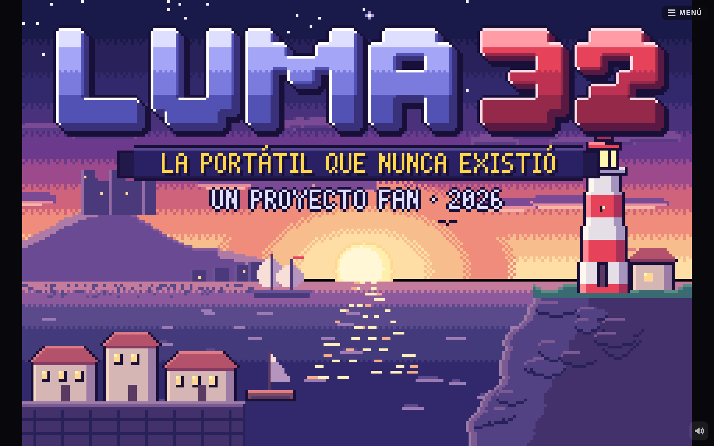
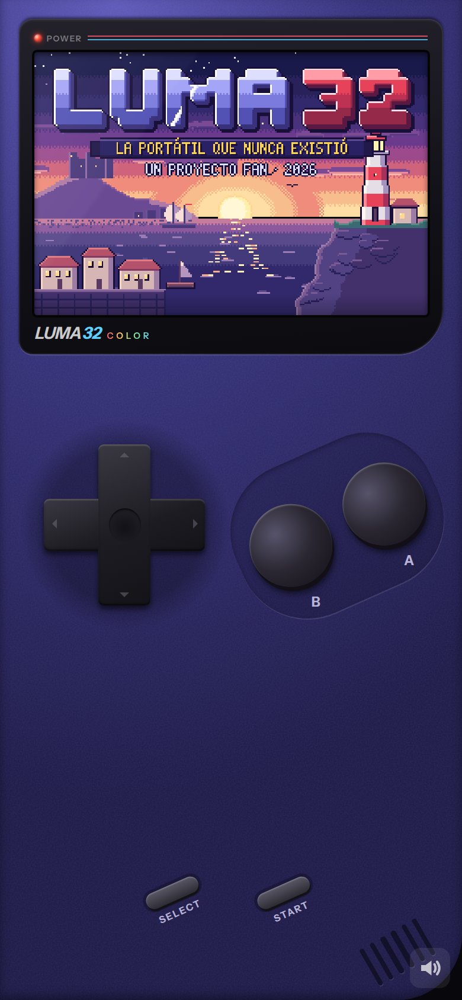

# LUMA 32

<p align="center">
  
  
</p>

A handheld console that only exists in the browser, and the engine its games run on. The
engine draws a 240×160 screen (the GBA's resolution) at 60 Hz: on a phone inside a drawn
handheld with an on-screen d-pad, A, B, START and SELECT; on a desktop or a tablet as the
whole window, played with the mouse, taps, the keyboard or a gamepad. No build step and no
dependencies: plain ES modules under `public/`.

A game for it is a **cartridge**: a folder with a `game.js` and whatever it loads — maps,
people, dialogue, scenes, songs. The engine knows no game. It provides the screen, the
controls, maps and people walking them, dialogue, saving, sound — and hooks. Every rule of
play belongs to the cartridge.

This repository is the engine and the tools to make games for it. It holds no games: they
are their makers' own repositories, and you add the ones you want.

[luma32.com](https://luma32.com) runs this engine as a service: an account there keeps its
games and saves in the cloud and plays them on any device.

## Playing on your computer

```sh
node server/serve.mjs                       # http://localhost:8765/
node tools/add-game.mjs dcimorra/luma32-example  # the example game, from GitHub
```

Node 20 or later, nothing to install. Any static file server over `public/` works too
(`cd public && python3 -m http.server 8765`).

## Adding games

`tools/add-game.mjs` puts a game on the shelf (`public/games/index.json`) from wherever it is:

```sh
node tools/add-game.mjs owner/repo                       # a GitHub repository, its default branch
node tools/add-game.mjs owner/repo@v1.2                  # a tag or a branch
node tools/add-game.mjs owner/repo/games/the-game        # a folder inside the repository
node tools/add-game.mjs https://github.com/owner/repo/tree/main/the-game
node tools/add-game.mjs ~/Downloads/the-game.zip         # a zip
node tools/add-game.mjs ~/src/my-game                    # a folder on this computer, linked
```

One repository, one game: a repository with more than one `game.js` (outside each other's
folders) is refused unless the path says which. A repository or a zip is unpacked into `public/games/<id>/`, keeping only what a game runs
on (scripts, JSON, images, fonts, audio). A folder is linked, not copied, so what you edit
there is what plays. `?game=<id>` in the address skips the shelf.

A game is code: add only games from people you trust.

## Making a game

**[luma32-example](https://github.com/dcimorra/luma32-example)** is a short, complete game
made the way a game should be: its layout, its `luma.json`, how to make one from it and
how to publish it. Copy it to start yours.

Start from `.claude/skills/luma32-games/` — the guide to making a cartridge, written for
[Claude Code](https://claude.com/claude-code) (open this folder in it and ask for a game),
and readable by anybody. Its `templates/` has a cartridge to copy. The sections below are
the engine's reference.

A cartridge lives in `public/games/<id>/` while you make it, and imports the engine with
relative paths (`import { Painter } from '../../engine/gfx.js'`). Keep it in a repository of
its own with `game.js` at its root (or in a folder of it), and that is how others add it.

### The package: `luma.json`

Optional, beside `game.js`. What a console says about the game before running it:

```json
{
  "id": "my-game",
  "title": "My Game",
  "author": "Who made it",
  "support": "https://github.com/me/my-game/issues",
  "homepage": "https://me.example/my-game"
}
```

Without it the id is the one `game.js` declares and the title its catalogue's `meta.title`.
`support` is where a player's problem reports go; for a game added from GitHub, its
repository's issues.

### Testing

`tools/` drives a real browser (`cd tools && npm install` once: `playwright-core`):
`shot.mjs` takes screenshots, `drive.mjs` plays with keys and keeps state between moves,
`audit.mjs` checks a cartridge's data at every dev jump. The skill's `testing.md` says how.

## Layout

- `public/index.html`, `engine/shell.css`, `engine/shell.js`: the console. On a phone the
  handheld (portrait: a tall body; landscape: the wide one), with a full-screen mode; on a
  desktop or a tablet, the screen alone, filling the window.
- `engine/host.js`: who the console answers to. Local (this repository served as files):
  the shelf is `games/index.json`, saves stay in the browser. Hosted: inside a frame of a
  page that holds accounts (see "Embedding").
- `engine/boot.js`: power on → logo → shelf → cartridge. `engine/cart.js`: a cartridge's
  title screen, then new game / continue.
- `engine/engine.js`: frame buffer, fixed 60 Hz loop, scene stack, fades/flash/shake/glitch.
- `engine/world.js`: maps, actors, collisions, camera, and `StoryApi` (what scripts call).
- `engine/ui.js`: dialogue boxes, choices, menus, chapter cards, location banners.
- `engine/font.js`, `engine/glyphs.js`: the bitmap font (accents composed, `¿¡ñ` included).
- `engine/doll.js`, `engine/creature.js`: people and animals (16×24, 4 directions × 3
  poses) generated from a spec.
- `engine/audio.js`: synthesised chiptune sequencer + effects + ambiences.
- `engine/weather.js`, `engine/vfx.js`, `engine/gfx.js` (`Painter`, the pixel-art API).
- `engine/groups.js`: sagas and collections on the shelf (`groups` in `games/index.json`,
  each a folder `public/groups/<id>/` with `group.js` and `locales/es.json`).
- `engine/report.js`: "Report a problem", from the pause menu: to the game's author (an
  issue on its GitHub repository, its `support` page) or, for the console, to this
  repository's issues.
- `locales/es.json`: the console's strings. Each cartridge brings its own.

Visitor-facing text never lives in code: scripts pass catalogue keys (`api.say('ana',
'market.ana_1')`). Code, comments and identifiers are in English.

## Embedding

A page that wants accounts, cloud saves or a library of its own puts the console in a
frame, preferably on another origin (a game is code: there it reaches nothing of the page),
and answers its questions by `postMessage` (`{ luma: 1, id, method, args }`, answered with
`{ luma: 1, re: id, ok, value | error }`):

| Method | Asks for |
| --- | --- |
| `hello` | `{ account, locked, shelf: { games: [{ key, id, src, group, kind, source, support }], groups }, token, wanted, saves }` |
| `saves` | to store `{ entries: { key: { value, at } } }` (save slots and lines read) |
| `account` | to open the page's account dialog; answered when it closes |
| `playing` | `{ game }`: the cartridge on screen, or null |
| `theme` | `{ color }`: the colour around the console |
| `report` | to send a problem report about the console |

The page may ask the console `flush` (send what is pending) and `forget` (drop this
account's saves from the device). Without an answer to `hello` the console runs local.

## A cartridge

`games/<id>/game.js` default-exports:

```js
{
  id, meta: { title, tagline },          // locale keys, shown on the shelf
  // meta.rating: 18 stamps "+18" on the cartridge label on the shelf (optional)
  strings: ['locales/es/common.json'],   // relative to the cartridge folder
  theme: { shell: {...plastic colours}, ui: { border, light, fill, text, shadow, accent,
           narration: {...}, speakers: { neo: { color, voice, text? } } } },
  tiles, dolls, maps, songs, effects, ambiences,
  player: 'dollId',
  title: { music, intro, pressY, menuY, draw(ctx, frame, engine, phase) },
  cover(ctx, x, y, w, h, frame),
  async newGame(api), async resume?(api),
  // optional
  saves: 3,                              // save slots (default 1), chosen on the title
  version: 2, migrate(save, from) {},    // see "Saves"
  slotLabel(save),                       // text of a slot (default: the map's name)
  portraits: { ana(ctx, x, y, frame, mood, state) {} },  // 40×40 faces beside dialogue
  figures: { ana(ctx, x, y, frame, mood, state) {} },    // full-body art for the stage, feet at (x, y)
  // state = { talking, mouth, blink }: open the mouth on `mouth`, shut the eyes on `blink`
  log: true,                             // "Historial" in the pause menu
  skip: true,                            // holding B skips lines read in any earlier play
  movement: 'free', hitbox: { x, y, w, h }, hud(ctx, api, e),   // see "Action games"
  modes: { swim: { speed: 0.75 }, fly: { height: 12 } },         // see "Getting about"
  direct: true, hint: false, memory: false,                     // see "Scripts", "Life on a map"
  autosave: false, recap: false,         // on by default: save on arriving somewhere; recall the objective on "Continuar"
  transition: 'iris',                    // how warps change place: fade (default), iris, wipe
  collections: { shells: { name: 'col.shells', total: 12 } },  // see "Journal and credits"
  dev: { jumps: [{ label, run: async (api) => {} }] },          // see "Dev mode"
}
```

## Saves

A save is position, `flags`, `choices` and `objective`, in `localStorage`, one key per
slot (slot 1 keeps the key it always had). Everything else is rebuilt from flags on load.
`v` is the engine's format, upgraded by the engine; `gv` is the cartridge's `version`. A
cartridge that changes what its flags mean bumps `version` and writes
`migrate(save, from)` returning the upgraded save (or null to drop it). A save it cannot
migrate is reported in the console and not offered, never loaded half-understood.

## Maps

```js
{
  name: 'place.market',             // locale key: banner shown on arrival
  music: 'office', ambience: 'office',      // or functions of the api (undefined: leave what plays)
  legend: { '#': 'wall_top', '.': 'carpet' },   // ground chars -> tile ids
  ground: ['#####', '#...#', ...],              // one string per row
  objects: [...rows], objectLegend: {...},      // optional: props by char (char = bottom-left cell)
  props: [{ t: 'desk', x, y, id?, when?, examine?, foot? }],   // props by list (x,y = bottom-left cell)
  actors: [{ id, doll, x, y, dir, talk: async (api, self) => {}, when: (api) => bool,
             move: 'wander'|'turn', radius, turn: false, turnBack: true,
             route: { path: [[x, y], [x, y, { face, pose, gesture, emote, bark, pause }], ...], back, pause, once },
             chat: { with: 'id', lines: ['key', 'note', ...], every, near }, look: 3, greet: 'key', bump: 'key',
             light, hint: false, remember: false, pose: 'sit', can: ['swim'], mode: 'fly' }],
  crowd: [{ id, doll, path: [[x, y], ...], every: ms, first: ms, talk, when }],  // passers-by
  warps: [{ x, y, to, at: [x, y], face, dir?, when?, run?: async (api) => {} }],
  triggers: [{ x, y, w, h, once: 'flag', when, run: async (api) => {} }],   // step on
  spots: [{ x, y, w, h, dir?, when, run: async (api) => {} }],              // press A facing
  enter: async (api) => {},        // runs after every arrival (guard with flags)
  grade: '#c8d8c0',                // multiply over the whole map (lighting)
  dark: { color, alpha },          // night: lit by props/actors with `light` and `lights`
  below: 'reef_floor', above: 'reef', breath: 12,   // diving (see "Getting about")
  lights: [{ x, y, r, color, flicker }],
  weather: 'rain',                 // rain storm snow blizzard leaves petals ash dust fireflies mist
  parallax: [{ speed: 0.2, draw(ctx, ox, oy, frame, api) {} }], // far layers where the ground is empty
  reverb: 0.3,                     // how the place rings (or { mix, size }): halls, caves
  sounds: [{ x, y, ambience, radius, volume }],   // ambiences at a spot, louder nearby
  direct: true,                    // directed conversations (see Scripts)
  hint: false,                     // no "A" over what the player faces
  guide: false,                    // no arrow to the objective on this map
  party: false,                    // the companions (game.party) stay out of this map
  refresh: true,                   // people and props follow the story mid-visit (see "Life on a map")
  actionA: true,                   // A doesn't talk on this map (see "Action games")
  overlay(ctx, api, cam, engine),  // drawn over actors (rain, darkness)
  underlay(ctx, api, cam, engine), // drawn over the ground, under props/actors
  void: '#000', run: false, shadows: false,
  heights: ['0011', '0122'], level: 8, drop: true,   // 2.5D (see "Heights")
}
```

The view is three-quarters from above, like the GBA RPGs: a horizontal wall is a row of
`wall_top` (seen from above) over a row of wall face. Solid tiles block. A warp on a solid
tile (a door in a wall) fires when the player walks into it; on a walkable tile, when the
player steps on it.

## Life on a map

People make a place. Three kinds of movement, all paused while a script runs:

- `move: 'turn'` looks around; `move: 'wander'` steps about within `radius` of home.
- `route` walks a path of cells on its own, planned again each step so whoever is in the
  way is walked round or waited for: `{ path, pause: ms | [min, max], back: true }`
  (`back` walks it back instead of starting over; `once` stops at the end). A function of
  the api picks the route from the story: a schedule by flags or hour.
- `crowd` on the map: passers-by. Each entry, every `every` ms (randomised), puts someone
  at the first cell of `path`, walks it and takes them away at the last. They appear and
  disappear only out of the player's sight or at a door (a warp or the cell beside one:
  they turn to it and go in), so the first and last cells are an edge off screen or a
  door. They are `transient`: not saved, not expected back. A function of the api gives
  the list for the moment of the story.

People live with each other and with the place, also data on the actor:

- A route point can say what is done there: `[x, y, { face, pose, gesture, emote, bark,
  pause }]` — the waiter turns to the bar and reaches over it, the old man sits on the
  bench for a while. The pose lasts until they walk on.
- `chat: { with, lines, every, near }`: two people near each other (within `near` cells,
  default 3) exchange lines in turn over their heads, without stopping the game: the first
  line is this one's, the next the other's. An emotion name (`note`, `dots`, `heart`…)
  instead of a key shows the bubble.
- `look: cells`: they turn to the player who comes that close; `greet: 'key'` says a line
  the first time the player comes near in a visit; `bump: 'key'` (or an emotion) when the
  player walks into them. Anyone bumped into turns round, unless busy at something.
- `api.bark(id, key)` is the same balloon from a script: a shout across the square, a
  remark while the player walks on.

**Companions**: `game.party` — a list, or a function of the api — of people who go where
the player goes: `party: (api) => [{ id: 'nieves', doll: 'nieves', talk, when }]`. On
every arrival (a warp, an edge, a reload) they stand behind the player and then walk in
their steps. They are walked through, not bumped, and answer A. A map that declares one
of them among its own `actors` gives them a role there instead (they stay where the map
puts them); `party: false` on a map leaves them all out. Being in the party is the
story's flags, so a reload brings them back the same.

Within a session the map remembers where its people stood when the player left, and
puts them back there on return (while their starting cell in the map's data is the
same). `remember: false` on an actor, or `memory: false` on the game, opts out. A reload
starts everyone from the map's data.

**The story moves on mid-visit.** A map chooses its people (`actors[].when`) and props
(`props[].when`) on arrival; `await api.refresh()` brings it in line with the story as it
stands: whoever the data now wants walks in from the nearest door (or is put at home out of
sight), whoever it no longer wants walks out by one, someone whose entry changed (same id,
another `when`) takes the new one where they stand and walks to its cell, and props come
and go in place. Behind a black screen it is instant; with no door in view they wait until
the player looks away. Someone already here under the same id (a `spawn`) counts as here:
nobody is doubled. `refresh: true` on the game or a map does it by itself after every
script and whenever the flags change.

Background chatter (`chat`, `greet`, `bump`) is cut when a script starts and resumes from
the first line a while after. A within 200 ms of a script ending doesn't interact.

## Light and weather

`weather` is a preset name, `{ kind, density, wind }` or a function of `(api, engine)`
returning one. `dark` (`{ color, alpha }` or a function returning it or null) darkens the
map, and every light on screen cuts it in stepped rings: a prop or actor with
`light: { r, color, flicker, dx, dy, steps }` (`steps` 2–8 rings, default 2: more is a
softer edge), and `lights` on the map (cells). The colour adds a
faint glow. `grade` still multiplies the whole map, before both.

## The objective and the guide

`api.objective(key, at)` says what the story wants next and **where**: a person
(`'ana'`), a cell of this map (`[x, y]`), or `{ map, x, y, w, h }` / `{ actor, map }`
elsewhere. `false` says on purpose that there is no one place. The save keeps both.

When the player stands still a moment, or just got a new objective, a small arrow bobs
over the place; if it is elsewhere on the map the arrow waits at the edge of the screen
pointing to it, and if it is on another map it points to the door or edge that leads
there (the shortest way through the maps' warps — their `to`, so give a warp with `run`
its `to` too — and connections). Touching it, the "A" hint takes over. `guide: false` on
the game or a map turns it off; players turn it off in Opciones.

Each time an objective is set or the player arrives on a map under one, the engine
checks it from the data: an objective without a place, a place nothing answers at, one
the player can't walk to from where they stand, a way to another map that no warp leads
through. Each is a `[luma]` warning. `world.audit()` (and `tools/audit.mjs`, at every dev
jump) adds what a player would get stuck on anywhere on the map: spots no reachable cell
touches, spots on open floor, people standing inside props or walls or on one another,
warps that land in a wall, people who don't answer.

## The player's comfort

START → "Opciones" holds the view, sound, text speed (slow, normal, fast) and, where the
browser can, vibration, kept per device. The engine autosaves when the player has
control after arriving at a new map (a small "Guardado" shows) unless the game says
`autosave: false`, and "Continuar" opens with one line, "Para seguir: <objective>",
unless `recap: false`.

## Journal and credits

`api.quest(id, state)` writes a quest in the save (`open`, `done`, `failed`) with a banner
and a sound; its texts are `quests.<id>.title`, `quests.<id>.note` and optionally
`quests.<id>.done` / `.failed`. `api.collect(set, id)` marks one thing found of a
`collections` set (once) and shows "Conchas 3/12". When there are quests or collections,
START shows "Diario": quests open first, then the rest, then each collection's count.
`api.credits(...)` scrolls the end credits over `bg`, then what was found and the time
played (`save.time`, counted by the engine), then "FIN" until A. They paint their own
black above the fade: fade out before them freely, and fade in (or end) after them.

## Open worlds

Maps of any size: only the cells on screen are drawn each frame. Maps can be joined edge to
edge, and the player walks across with no fade, seeing the neighbour before reaching it:

```js
town: { ..., connections: [{ dir: 'east', map: 'route1', offset: 2 }] },
route1: { ..., connections: [{ dir: 'west', map: 'town', offset: -2 }] },
```

`offset` slides the neighbour along the shared edge, in tiles (the two sides must
mirror each other). A connection may have `when`. Only direct neighbours are shown, not
diagonal ones. On crossing, the neighbour becomes the current map: its `enter` runs, its
banner and music change if different, and the save records it.

## Hooks for the cartridge's rules

Each hook can live on a tile definition, a map or the game manifest; the engine asks them
in that order.

| Hook | Called | Returns |
| --- | --- | --- |
| `canEnter(api, { x, y, tile, def, who, dir, player })` | before anyone steps on a cell | `false` blocks, `true` lets through even a solid tile, `undefined` defers |
| `onStep(api, { x, y, dir, tile, map })` | after each player step (if no warp or trigger fired) | an `async (api) => {}` to run as a script, or nothing |
| `onBump(api, { x, y, dir, tile })` | when the player walks into something | a script, or nothing |
| `update(api, engine, control)` (map, game) | every frame; `control` = the player has control | — |
| `grade(api, engine)` (map) | every frame: the light over the map | a colour or `null` |

Return a script only when something happens: a plain step must not start one, or walking
stutters. `api.player.baseSpeed` sets the walking speed (B doubles it), for bikes or mud;
the modes of "Getting about" multiply it.

## Getting about

Swimming, diving, flying and climbing are abilities; water, sky and cliffs are
**mediums** on tiles (`engine/move.js`). A medium is a wall to whoever can't use it;
whoever can walks straight in, and their **mode** follows the ground under them — nobody
presses a button to swim. The way in and out shows and sounds (a splash, wings and dust,
a landing, a grip), and each mode has its look:

| Mode | Where | Looks | Speed (B runs) |
| --- | --- | --- | --- |
| `swim` | `medium: 'water'` or `'deep'` | up to the shoulders, a ring of ripples, a wake, arms in turn | 1 (yes) |
| `dive` | every cell of a map with `above` | arms out, blue, swaying, bubbles | 0.75 (no) |
| `fly` | `medium: 'air'`; over water, cliffs and anything `low` or a `ledge` | up in the air with its shadow below, arms like wings | 1.5 (yes) |
| `climb` | `medium: 'climb'` | from behind, hand over hand | 0.5 (no) |

```js
// tiles
sea:   { medium: 'water', step: 'water', foam: '#e8f6ff', draw },   // foam: the ripples' colour
deep:  { medium: 'deep', draw },          // swim; A dives to the map `below`
chasm: { medium: 'air', draw },           // only flyers cross
vine:  { medium: 'climb', draw },         // only climbers
ice:   { medium: 'ice', draw },           // anyone on foot slides until something stops them
belt:  { push: 'right', pushSpeed: 1, draw },   // a current, a walkway: carries the player one way
fence: { low: true, size: [1, 1], draw }, // a prop (or a solid tile) a flyer goes over

// who can
api.grant('swim'); api.revoke('swim'); api.can('fly')      // the player's: flags `can.<ability>`
{ id: 'gull', doll: 'gull', mode: 'fly', move: 'wander' }  // always in that mode (a fish: 'swim' keeps to water)
{ id: 'nix', doll: 'nix', can: ['swim'], route: [...] }    // may, where the ground asks
api.setMode('player', 'fly'); api.setMode('player', null)  // held: up whatever the ground; false if they can't land there
api.mode('ana')                                            // walk swim dive fly climb

// diving: two maps with the same cells, one over the other
reef:  { below: 'reef_floor', ... },                       // A on a deep cell goes down to the same cell
reef_floor: { above: 'reef', breath: 12, grade: '#a8c8f0', ... }   // A under deep water comes up
game.modes = { swim: { speed: 0.75 }, fly: { height: 12, speed: 1 } }   // the cartridge's own tuning
```

- The player's abilities are flags, so a reload restores them; companions share them and
  follow the player into the water and the air. A held mode is not saved: restore it in
  `enter` from the story's flags.
- **Diving** is a map below: A on `deep` water (with `dive`) fades to the same cell of the
  map named by `below`, and A where the map `above` has deep water comes back up. The "A"
  hint shows where it can be done. Everyone on a map with `above` is diving. `breath:
  seconds` shows an "Aire" bar that runs down while the player has control; when it is out
  they come up at the nearest deep water above.
- **Ice and currents** move the player only, on foot, in grid movement. Ice keeps them
  going the way they went until something stops them, onto the first cell that isn't ice;
  a `push` tile carries them without turning them. Warps on the way are taken.
- The guide, the audit and every path search use the same rules: an objective across the
  water is unreachable until the player can swim, and the engine says so. An objective
  on the other level points the arrow at the nearest deep water.
- `canEnter` hooks still come first and win; a solid tile without `medium` behaves as
  before. New effects: the `bubbles` burst; sounds `splash stroke flap land dive surface
  grip slide gasp`; the doll pose `fly`.

## Heights

A map may stand on several levels — a mesa, a tower, terraces, a raised road — and the
engine draws them in 2.5D: each cell's top rises `level` pixels a level (8 by default; a
map's or the game's `level`), with its face below it down to the next cell's top, light
from the upper left (a lower cell beside a higher one lies in its shade) and a line of
shade where a face meets the ground. Raised cells are sorted with the props and the
people, so whoever walks behind a wall is hidden by it, and whoever stands on top is drawn
up there, with their shadow, hint, emote, bark, light and effects.

```js
heights: [               // one digit a cell (0-9), over `ground`; missing rows and cells are 0
  '0000000',
  '0111110',
  '0112110',
],
level: 8,                // pixels a level (map or game)
drop: true,              // walking off a higher cell onto a lower one hops down (map or game)

// tiles
stairs: { ramp: true, draw, side(p, frame, h) {} },   // the way between two levels
mesa:   { draw, side(p, frame, h) {} },               // its own face, h pixels tall
```

- One may walk between cells on the same level, or one level up or down where either
  cell is a `ramp`. Anything else is a cliff: a wall, unless `drop` lets you hop down it,
  or you fly. Every path search, the guide, the audit and a click on the map use the same
  rule; a click lands on the raised top under the pointer.
- A tile's face is its `side(p, frame, h)`, painted on a 16×`h` Painter; without one the
  engine carries the tile's bottom row down, shaded, with a seam at every level.
- `api.setHeight(x, y, h)` raises or lowers a cell from a script (a bridge, a lift).
- Props stand on the height of their bottom-left cell; a `flat` prop on a raised cell lies
  on it. A map without `heights` is drawn exactly as before, pixel for pixel
  (`tools/compare.mjs` checks it against every cartridge).

## Mode 7

`engine/mode7.js` lays a picture on the ground and shows it in perspective, as the GBA's
affine backgrounds did: a flight, a sail across a sea, a race, a world map. It only draws;
who steers and what happens is the cartridge's.

```js
import { Mode7 } from '../../engine/mode7.js';
const m7 = new Mode7({ ground: canvas, wrap: true, outside: '#000', sky: ['#203048', '#a0c0e0'],
                       fog: { color: '#a0c0e0', far: 800, from: 0.4 }, fov: 1.2 });
m7.cam = { x, y, angle, height: 40, horizon: 40 };   // ground pixels; angle in radians, 0 is north
m7.draw(ctx);                                         // in a scene's draw
m7.sprites(ctx, [{ img, x, y, z, scale }]);           // standing up, far ones first
m7.project(x, y, z);                                  // { x, y, scale, depth } on screen, or null
api.mapImage(frame, { props: 'flat' })                // the current map as a picture, for ground
```

`sky` is a colour, `[top, bottom]` or `sky(ctx, cam, horizon)`. `ground` can be any canvas:
a map (`api.mapImage()`), or one painted with a `Painter` for the occasion.

The ready-made use is **`api.flyover(opts)`**: the current map from the air, the camera
gliding from `from` to `to` (cells; by default from the player, `ahead` cells forward),
turning from `angle` to `turn` (degrees), at `height` pixels, in `ms`; props stand up and
the people on the map are drawn where they stand. A skips it (`skip: false` doesn't).

```js
await api.flyover({ from: [12, 30], to: [12, 4], turn: 30, ms: 5000, height: 48 });
```

## Two bodies, one cell: never

Nobody walks into a cell someone stands in, solid or not; the player passes only
through their companions (`game.party`), who step aside along the player's trail.
Someone set on an occupied cell — by the map's data, `api.spawn` or a cutscene's
`walkTo(…, { place: true })` — goes to the nearest free cell, and the engine warns.

## Tiles and props

One registry for both. A tile is 16×16; a prop may be bigger and is drawn y-sorted with the
actors, anchored at its bottom-left cell:

```js
desk: { size: [2, 2], foot: [2, 1], frames: 2, examine: 'key',
        draw(p, frame) { p.rect(0, 13, 32, 19, '#16201a'); ... } }
```

`solid` (tiles), `foot` (props: solid cells from the bottom-left, default the bottom row;
`[w, h, dx, dy]` starts them dx cells in and dy up — the trunk of a wide tree),
`over` (always above actors), `flat` (always below), `counter` (talk across it), `z`,
`ledge: 'down'` (solid, but walking that way hops over it to the cell beyond),
`ramp` and `side(p, frame, h)` (see "Heights"),
`medium`, `push`, `low` (see "Getting about"),
`step` (the footstep on this ground: an effect name or `soft hard wood snow water`),
`dust` (the puff a runner kicks up here: a colour, or `false`; `dust: false` on a map or
the game turns it off),
`reflect` (still water: people at its edge show upside down in it; a number sets the opacity),
`auto` (an autotile: `true` or a group name; `draw(p, frame, mask)` gets which of the eight
neighbours are the same group — `EDGE` bits in `engine/gfx.js` — and `p.edge(mask, { color,
width, inner, round })` paints a rim along the sides and corners that border other ground),
`light` (props: see "Light and weather"),
`top(p, frame)` (a second 16×16 layer painted over whoever stands on the tile — y-sorted, so it never covers someone in the cell below: tall grass,
the edge of a roof).
A prop entry on a map may carry its own `examine` (this desk, not every desk) and `foot`.
`examine` (on a kind, a tile or an entry) may be a function `(api, thing) => key`; `null`
falls back to the kind's, then the tile's.
`Painter` gives `fill rect px hline vline box dither noise line ellipse pix stamp` and a
seeded `rand`. Art is code: there are no image files. The one exception is the home-screen icon:
`engine/icon-{180,192,512}.png` are `engine/icon.svg` rendered full bleed (iOS takes no SVG
there); after changing the SVG, render them again with Chromium (`tools/`).

## Scripts (`StoryApi`)

```js
await api.say('ana', 'market.ana_1')        // a key; array values become several boxes
await api.narrate('market.intro')           // no speaker
const i = await api.ask('ana', 'market.ana_ask', ['market.yes', 'market.no'])
api.choose('help_ana', i)                   // remember a decision, in order
api.set('flag'); api.is('flag'); api.inc('n')
await api.warp('market', 4, 5, 'up')
const a = api.actor('ana'); await a.walk('3l2u'); await a.walkTo(5, 6); a.face('down')
await a.walkTo(5, 6, { timeout: 4000, place: true })   // never freezes: stands there if blocked
a.place(5, 6, 'up')                                    // at once (behind a cut)
a.setPose('sit'); a.setPose(null)          // sit kneel lie sleep reach cheer fly blink; walking stands up
api.grant('swim'); api.can('swim'); api.setMode('player', 'fly'); api.mode('ana')  // see "Getting about"
await a.gesture('nod')                     // nod shake hop shiver bow
await a.jump(); await a.jump('right', { n: 2 })   // scenes only: on the spot, or over cells (api.jump(id, dir, opts))
a.nudge(4, 0)                              // a few pixels off the cell until the next step (a hug)
await api.letterbox(true); await api.letterbox(false)     // cinema bars
await api.fadeOut(400, '#000', { kind: 'iris', at: 'player' }); await api.fadeIn(400)  // fade iris wipe
await api.warp('inn', 3, 4, 'up', { transition: 'wipe' })
api.quest('lamps'); api.quest('lamps', 'done'); api.questState('lamps')   // the journal
api.collect('shells', 'beach_1'); api.collected('shells')
await api.credits({ lines: ['credits.thanks', { title: 'credits.music', names: ['…'] }], music, bg })
api.spawn({ id, doll, x, y, dir, transient? }); api.despawn(id)   // transient: just passing by
// a sprite actor: sprite: 'tileId' or { down, up, left, right }; shadow: true draws its drop shadow
await api.refresh()                         // the map's people and props follow the story now (see "Life on a map")
api.addProp({ t: 'wardrobe_open', x, y, id: 'wardrobe' }); api.removeProp('wardrobe')   // this visit; the same id replaces
const won = await api.control(startFight(api))   // the player has the world until it settles
await api.together(a.walk('2r'), b.walk('2l'))
await api.emote('ana', '!'); await api.pan(x, y); await api.follow()
await api.emote('ana', 'heart')            // heart anger sweat note idea sad shock dots zzz, or any glyph
api.rumble(80)                             // the phone vibrates (api.shake does too)
await api.fadeOut(); await api.fadeIn(); await api.flash('#fff'); await api.shake(); await api.glitch()
await api.appear({ id, doll, x, y }, { fx: 'shadow' }); await api.vanish('rhys', { fx: 'poof' })   // see "Visual effects"
api.fx('sparkle', 'ana'); await api.animate('ana', { lift: 6 }, 500); await api.zoom(2, { at: 'ana' })
api.music('title', { fadeIn: 1 }); api.musicLayer('chase', true); api.sfx('door'); api.ambience('rain')
await api.music('win'); api.music('j_item', { over: true, duck: 0.3 })   // see "Music"
api.objective('obj.door', 'ana')            // what next, and where: a person, [x, y], { map, x, y } (see "The objective and the guide")
api.bark('ana', 'market.shout')             // a line over a head that doesn't stop the game
api.banner('place.market')
await api.card({ kicker, title, sub, bg, color, accent, frames })
const result = await api.play(new MyMinigame())   // any scene: { update(e), draw(ctx, e) }, calls this.done(v)
api.persist()                                     // write the save slot
await api.say('ana', 'key', { mood: 'smile' })    // mood reaches the portrait (and figure)
const k = await api.list([{ label, value, note, disabled }], { title })  // scrolling; -1 on B
await api.showLog()
const st = api.stage({ bg(ctx, f) {}, music })    // full-screen backdrop (engine/stage.js)
st.show('ana', { at: 'left', mood }); st.mood('ana', m); st.move('ana', 'right'); st.hide('ana')
await st.close()
```

A walk resolves `false` (instead of hanging) if its actor leaves the map or is despawned,
and `walkTo` plans again around whatever steps in the way, giving up after 1.5 s without
progress.

**Directed conversations** (`direct: true` on the game or a map; `{ player: '<speaker id>' }`
when the player's own lines use a speaker id): before each line its speaker turns to
whom they answer and that one turns back; a speaker off screen or under the box gets the
camera, which returns to the player when the script ends. People answer each other from
talking distance: when a line answers someone more than three cells away, or through a
wall, the one free to walk (not the player, not someone sitting or lying) first walks
over to them; if nobody can, the engine warns. `{ far: true }` on a line is a shout
across the place; `{ approach: false }` in the `direct` object turns the walking off
(the warning stays). `{ direct: false }` on one line skips all of it.

**The "A" hint**: when the player stands still facing something that answers A (a person
with `talk`, a live spot, a prop or tile with `examine`), a small "A" shows over the
person or the player. `hint: false` on the game or a map turns it off; on a spot or an
actor it keeps that one secret.

**Text effects** inside a line of the locale: `{shake}…{/}` trembles, `{wave}…{/}` floats,
`{c=#e05038}…{/}` or `{c=accent}…{/}` (a theme colour; `{c=speaker}`) colours, `{p}` pauses
the typing a moment and `{p=800}` for that many ms. Unknown braces stay as written, so
`{name}` variables are untouched.

`api.menu` and `api.ask` scroll when there are more options than fit. For a cartridge's own
screens `engine/ui.js` exports `panel`, `bar` (gauges; `steps` for hearts or pips) and
`textBox` (wrapped text), plus `List` and `Choice`.

An actor with `sight: { range, flag, when, run(api, self) }` stops the player who walks
into its line of view: it shows '!', walks up and `run` plays. `flag` is set first, so it
happens once.

A scene gets `e.input` (`pressed('a')`, `held('left')`, `dir()`), `e.frame`, and draws on a
240×160 context. Set `opaque = false` to see the world under it; `aboveFade = true` to stay
visible during fades.

## Visual effects

Particles, people's looks for a moment and the camera's own effects (`engine/vfx.js`).
None of it is saved, and what is in the air when the map changes is dropped.

```js
api.fx('poof', 'ana')                       // a burst on someone, a cell [x, y] or { px, py }
await api.fx('sparkle', [5, 6], { color: '#ffd860', amount: 2, scale: 1.5 })   // resolves when gone
api.fx('splash', [3, 4], { sound: 'splash', front: false, feet: true, dx: 0, dy: -4 })
const aura = api.emitter('magic', 'rhys', { every: 300 }); aura.stop()   // until stopped or the map changes
await api.appear({ id: 'rhys', doll: 'rhys', x: 5, y: 4, dir: 'down' }, { fx: 'shadow', ms: 300, sound: 'winnow' })
await api.appear('rhys')                    // someone already here with visible: false
await api.vanish('rhys', { fx: 'shadow' })  // leaves the map (as despawn); keep: true only hides
await api.animate('ana', { alpha: 0.5, lift: 8, ox: 4, oy: 0 }, 400, { ease: 'out' })  // linear in out inOut back bounce step
await api.tintActor('ana', '#ff3030', 250)  // a colour over the body that fades (a hit); ms 0 stays, null clears
api.trail('rhys', { color: '#6a50d0' }); api.trail('rhys', false)      // afterimages while moving ({ still: true }: always)
await api.zoom(2, { at: 'ana', ms: 400 }); await api.zoom(1)            // the camera closes in; undo it before control returns
await api.wave(3); await api.wave(0)        // the picture waves row by row: a dream, heat, a spell
```

The effects: `poof` (a cloud: someone appears or goes, something lands), `smoke` (rising,
for an emitter: a chimney, a ruin), `shadow` (dark wisps: darkness, teleporting through
the night), `sparkle`, `magic` (motes spiralling up, a ring at the feet), `dust` (a low
puff), `embers` (sparks rising), `shards` (pieces flying and falling: something breaks),
`splash`, `bubbles` (rising and swaying: under water, a pot boiling), `hearts`, `leaves` (`color` for petals or snow), `ring` (a shockwave on the
ground), `burst` (lines out of a point: a hit) and `glow` (light swelling). `color` takes
one colour or a list from light to dark; `amount` and `scale` multiply how many and how
big. Rings, dust and splashes lie on the ground under people; the rest goes over them,
and what shines (`embers`, `magic`, `glow`) shows through the map's `dark`.

A cartridge adds its own as `game.fx = { petals: (o) => [...] }`, `o` being `{ x, y, color,
amount, scale }` in map pixels, returning particles made with `particle({ x, y, vx, vy, g,
drag, swirl, wob, life, size, grow, alpha, colors, shape, shade, add, floor })` from
`engine/vfx.js` (shapes: `px dot disc ring star streak heart leaf halo`).

A map keeps effects going on every visit with `fx: [{ name: 'smoke', x: 4, y: 2, every: 250,
when: (api) => api.is('fire'), dy: -10 }]`.

`api.appear` and `api.vanish` are the way someone comes or goes in plain sight when the
story says so (magic, a ghost, a teleport): they don't trigger the warning about people
popping in view. An actor brought by `appear({ … })` is spawned like `api.spawn`, with the
same rules about coming back on the next visit.

## Action games

`movement: 'free'` (on the game or one map) moves the player by pixels with a hitbox at
its feet (`hitbox`, default `{ x: 3, y: 9, w: 10, h: 6 }` inside the 16×16 cell) and
slides it around corners. Warps, triggers, spots, talking and edges work as before, on the
cell under the hitbox's centre. B runs unless `run: false`; `actionA: true` frees A from
talking for the cartridge's own use (also on one map).

Entities are what moves on its own: enemies, projectiles, blocks.

```js
api.addEntity({ x, y, w, h,              // hitbox in map pixels
  solid: true,                           // stops the player and other entities
  bumpsActors: false,                    // stopped by actors too
  update(api, e, self) {},               // every frame the player has control
  draw(ctx, sx, sy, e, self) {} })       // at the box's top-left on screen, y-sorted
api.move(self, dx, dy)                   // → { x, y, hitX, hitY }, against the map
api.overlaps(self, 'player'); api.box('player'); api.solidPixel(x, y); api.removeEntity(self)
```

Entities are not saved and vanish when the map changes: add them in `enter`, from flags.
`hud(ctx, api, e)` on the game or a map draws over the world (hearts, a counter).

## Music

```js
title: {
  bpm: 138, steps: 4, swing: 0, loop: 1, once: false,
  channels: { bass: { inst: 'bass' }, arp: { inst: 'pulse12', echo: .35 }, drums: { inst: 'drums' } },
  patterns: { A: { bass: 'E2 . E3 . E2 - - .', drums: 'k . h . s . h .' } },
  song: ['A', 'A', 'B'],
}
```

A channel with `layer: 'name'` plays only while `api.musicLayer('name', true)`: the same song
gains drums when a chase starts. `api.music(name, { fadeIn: s })` rises while the old one
fades. `unless: 'name'` is the reverse: the channel plays only while that layer is **off**
— a voice lost or swapped at a switch, or a channel of the playing song silenced. Both
switch on the next note.

`api.music(name)` returns a promise: a `once` song's resolves when it ends (or is
replaced), any other's at once — `await api.music('win'); api.music('town')`. A `once`
song that ended plays again when asked. `api.music(name, { over: true, duck: 0.3 })` plays
a jingle over the place's song, which ducks to `duck` of its level and comes back when it
ends (`jingle(name, opts)` from `engine/audio.js` in a scene).

One token per step: a note (`C#4`), `-` holds, `.` rests; `!` after a note or drum accents
it (+3.5 dB), `?` softens it (−5 dB): `C5! D5 E5? -`, `k! h h? h`. Channels shorter than the
pattern repeat. A pattern may have its own `bpm` (`songClock()` counts in the song's).
Instruments: `pulse12 pulse25 pulse50 tri bass saw sine bell pluck pad`, `noise` (a band of
noise around the note — breath, wind — with `q`, `lp`, `attack`, `decay`; never real), and
`drums` with `k s h o c t r`.

Effects get `(opts, { tone, burst, ctx, now, dest })`: nodes an effect builds go to
`dest`, the effects bus, so mute and the room apply. `burst` plays any length.

`node tools/render-song.mjs <game> <song> <out.wav> [--chiptune] [--layers a] [--secs N]`
renders a song (`--sfx`: an effect) offline to a WAV and prints its level per second; the
same song renders the same samples every time. `--list` names the game's songs.

## Real instruments

Songs play recorded instruments instead of the console's chiptune, the way the GBA's own
music was made (Golden Sun, the Final Fantasy ports): notes of real instruments, pitched
to every key. **It is the default**: every game has an orchestra unless it says
`orchestra: false`, and every song written for the chiptune is heard on it. They come from FluidR3_GM (MIT, Frank Wen; the notice is in
`engine/instruments/LICENSE.txt`), cut down to a few notes each by `tools/instruments.mjs`
into `engine/instruments/` — 2.8 MB in all, each MP3 downloaded the first time a song
needs it, and the game's all fetched in the background once sound is on.

```js
// the whole game (default true): every channel becomes the real instrument that stands
// in for its own — pulse12 harp · pulse25 flute · pulse50 clarinet · tri horn · saw brass
// bass fingerbass · sine panflute · bell celesta · pluck guitar · pad strings · drums kit
orchestra: { pad: 'choir', pulse25: 'oboe' },     // the same, some changed: the world's own
orchestra: false,                                 // the console's chiptune, every song
// a song: its own `orchestra` (true, a map, or false to stay chiptune)
// a channel
lead: { inst: 'violin', vol: 1 },                  // a real instrument by name
arp: { inst: 'pulse12', real: 'harp' },            // chiptune written, harp heard
ctr: { inst: 'pulse25', real: false },             // stays chiptune whatever the orchestra
```

Real instruments: `piano epiano harpsichord celesta glockenspiel musicbox vibraphone
marimba organ accordion guitar steelguitar fingerbass fretless violin cello pizzicato harp
timpani strings choir trumpet trombone horn brass sax oboe bassoon clarinet flute panflute
whistle ocarina sitar koto kalimba bagpipe fiddle taiko`, and `kit` for drums (`k s h o c t
r` on a real kit). No real instrument shares a name with one of the console's: `inst:
'bass'` names the console's bass, which the orchestra then plays as `fingerbass`.

- A real instrument keeps the song's mix: it plays as loud as the console's instrument it
  stands in for (`vol` as before), with `echo`, `transpose`, `gate` and layers.
  `wave`, `lp`, `detune` and `vibrato` are the chiptune's and don't apply.
- A song waits for its instruments (a few seconds at most; then what is missing plays as
  chiptune) and never starts half one, half the other.
- In a game with an orchestra, Options has "Instrumentos: REALES / CHIPTUNE" (REALES to
  begin with), for the player; the song playing changes at once.
- `node tools/instruments.mjs build <FluidR3_GM.sf2>` makes the set again (the list, the
  range and the notes kept of each are at the top of the tool).

## Warnings the engine prints

Things that play wrong without throwing are printed once each as `[luma] <game> · <map>: …`
in the console: an actor spawned or despawned in view (not at a door, not behind a fade),
a spot under the player's feet or one cell past what they bumped into, a person without
`talk`, on leaving a map anyone who was there only by `api.spawn` and whom the map's
`actors` won't bring back (spawn with `transient: true` for people just passing by), a
text key with no text (the player would read the key), a scene pushed while the screen
is faded to black, control back with the screen still black (it fades in after half a
second), `Painter.line` given a NaN (nothing drawn), two people answering each other from
across the place, and the objective checks of "The objective and the guide" (with
`?dev=1`, the whole audit).

## Dev mode

`?dev=1` in the URL draws, over the map, the grid, the cells that block (red), spots
(yellow; faint when their `when` is false), triggers (magenta), warps (cyan), routes
(green dots), each actor's id (white: from the map's data; green: transient; red: only
by spawn) and the map and cell at the top. F2 hides and shows it. F3 opens a jump menu:
the cartridge's `dev: { jumps: [{ label, run: async (api) => {} }] }` (set the flags of a
point in the story and warp there), then every map.

## Testing by eye

```
cd tools && npm install          # once: playwright-core, pinned
PORT=8765 DATA_DIR=/tmp/luma32-data node server/main.mjs   # or any static server, without accounts
node tools/shot.mjs http://127.0.0.1:8765/?game=<id> /tmp/m script.json
```

`node tools/audit.mjs "http://127.0.0.1:8765/?game=<id>" [first] [last] [--follow [secs]]`
starts a new game and runs every dev jump (pressing A through their scenes), and after each
one lists the engine's audit, the `[luma]` warnings and the console errors: where a player
would get stuck, at every point of the story, in one run. A jump with a long set piece gets
`timeout: <secs>` in `dev.jumps` (45 by default, `AUDIT_JUMP=` for all). `--follow` plays
each jump on into its next beat with `tools/play.mjs` (60 s) and lists, as `follow:`,
where it got stuck, someone it couldn't find or a place it couldn't reach. `play.mjs`
crosses maps by warps (those whose `when` is open) and `connections`.

`node tools/sheet.mjs http://127.0.0.1:8765 <id> /tmp/sheet.png` draws a cartridge's whole art on
one contact sheet (ground tiles 3×3, props, dolls with their silhouettes) and reports colour
counts and ground tiles whose edges stand out when repeated. `--only dolls` (or `tiles`,
`props`) and `--match <text>` narrow it; over 4000 px it goes on pages (`sheet-2.png`…);
dolls are drawn at their frame's own size, and a spec with `frames` as built.

`script.json` is a list of `{ wait }`, `{ key, hold, times }`, `{ shot }`, `{ screen }`,
`{ eval }`, `{ until: 'js', timeout }` (waits for a condition, e.g. the title's
`luma.engine.top()?.phase === 'press'`). `VP=390x844 TOUCH=1` emulates a phone.

`tools/lab/` is the engine's own test cartridge: ledges, tall grass, a watcher, a bag, the
stage, portraits, the log, slots with migration, a cave with free movement, an enemy,
a pushable block and a HUD, and a plaza with a crowd, a route, a wanderer, the A hint,
a directed conversation where the guard walks over to answer, two people chatting by the
pond, someone who greets you, a guard who stops on his round, a companion who follows, an
objective whose guide leads from the town to the plaza's well, footsteps, lamps at night, snow and fireflies, poses and
gestures, text effects, a portrait that talks and blinks, cinema bars, an iris door, a
pond that reflects, a quest, a collection and the credits (behind the east door of the
town; the credits and every visual effect from the dev menu), with an autotiled pond, a sound at the pond, emotion
bubbles, and an echo in the cave; and a shore (from the dev menu: on foot, with every
ability, in held flight) with sea to swim, deep water to dive into a reef with a breath bar,
a chasm to fly over, a cliff to climb, ice, a current, a fence a flyer crosses, a gull that
always flies and a swimmer who never leaves the water; a hill with heights (a mesa, a tower,
stairs, an edge to drop off, someone walking behind it) and a flyover of the plaza in Mode 7
(both from the dev menu). After changing the engine, link it in
(`ln -s ../../tools/lab public/games/lab`), boot `?game=lab`, then remove the link: the
folder under `public/` is served to everyone.

`node tools/compare.mjs <base url> <candidate url> [game ...]` draws every map of every
cartridge (each whole, a screen at a time, game time stopped and `Math.random` seeded) with
two builds of the engine and compares them pixel by pixel: serve the engine as it was on one
port and the changed one on another, and a change that should leave old games alone is
shown to do so.

A cartridge may read a URL parameter of its own in `newGame` to start at a given point of
its story (Matrix: `?game=matrix&dev=<chapter>`).
